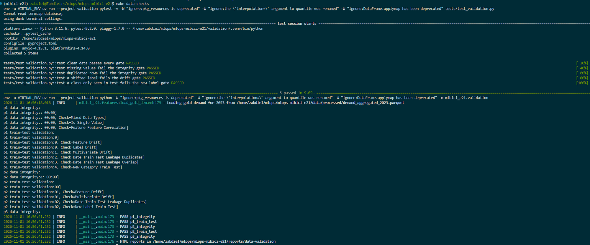
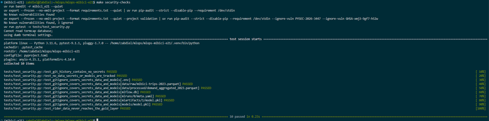

# MLOps MiBici — Equipo 21

Demand forecasting, station risk classification, and station clustering for the MiBici bike-sharing system in Guadalajara, packaged as a reproducible [MLflow Project](https://mlflow.org/docs/latest/ml/projects/) on top of a data-lake ingestion pipeline.

| Question | Task | What it answers | Registered model |
| --- | --- | --- | --- |
| P1 | Regression | How many bikes leave each station in each hour? | `mibici-equipo21-p1-demanda` |
| P2 | Classification | Which stations will end the day empty or full? | `mibici-equipo21-p2-riesgo` |
| P3 | Clustering | Which stations behave alike, so they can be rebalanced as a group? | `mibici-equipo21-p3-grupos` |

| ID | Name |
| --- | --- |
| A0173318 | Berenice Chapuli Xochimitl |
| A01702737 | Walter Gonzalo Fernandez Deza |
| A01374964 | Jesús Zabdiel Sánchez Chávez |
| A01639802 | Alejandro Gil Ruiz |

<div align="left">
  &nbsp;
  &nbsp;
  &nbsp;
  &nbsp;
  &nbsp;
  &nbsp;
  
</div>

---

## Contents

- [Data architecture and pipeline](#data-architecture-and-pipeline)
- [Quick start](#quick-start)
- [MLflow Project and tracking](#mlflow-project-and-tracking)
- [Model Registry and lifecycle](#model-registry-and-lifecycle)
- [Model serving](#model-serving)
- [Quality and security checks](#quality-and-security-checks)
- [Makefile](#makefile)
- [Project organization](#project-organization)
- [Git and GitHub workflow](#git-and-github-workflow)

---

## Data architecture and pipeline

The pipeline downloads the monthly CSVs from the MiBici open-data portal (bronze, `data/temp/`), casts them to strict PyArrow schemas and publishes yearly Parquet files (silver, `data/raw/`, shared on Hugging Face), then cleans and aggregates them into the station-demand tables the models train on (gold, `data/processed/`).

| Document | What it covers |
| --- | --- |
| [docs/data-pipeline.md](docs/data-pipeline.md) | Data source, ingestion and schemas, storage and versioning, cleaning and gold features, and the handoff to modeling. |
| [docs/testing-e2e-flow.md](docs/testing-e2e-flow.md) | Steps from a clean clone to batch predictions served by the champion models. |

---

## Quick start

> [!NOTE]
> You need Python 3.11 and [`uv`](https://docs.astral.sh/uv/getting-started/installation/). `uv sync` creates `.venv` with the locked dependencies of `uv.lock`, including the development tools.

```bash
git clone https://github.com/yako-2792/mlops-mibici-e21.git
cd mlops-mibici-e21
uv sync
source .venv/bin/activate
```

> [!IMPORTANT]
> Credentials and settings that change per machine live in a `.env` file at the project root, which is gitignored. Start from the template, which lists every variable without real values:
>
> ```bash
> cp .env.example .env
> ```
>
> Uploading to Hugging Face needs `HF_TOKEN`. The dataset id is `HF_DATASET_REPO` in `mibici_e21/config.py` (`yako2792/mibici-dataset`), not an environment variable.

> [!TIP]
> `make help` lists every command. Ingestion writes Parquet locally. `HF` defaults to `false`, so a run does not upload until you pass `HF=true`.

To train and register the models, continue with [MLflow Project and tracking](#mlflow-project-and-tracking).

---

## MLflow Project and tracking

Every ingestion, baseline, search, and candidate run is launched with `mlflow run`, and all of them live in one experiment, `mibici-equipo21`. The `stage_of_work` tag tells baselines, searches, and candidates apart.

### 1. Start the tracking server

The Model Registry needs a database-backed store. In a dedicated terminal, start a local server with SQLite:

```bash
uv run mlflow server --backend-store-uri sqlite:///mlflow.db --default-artifact-root ./mlartifacts --port 5000
```

`make mlflow-server` runs the same command. `mlflow.db`, `mlartifacts/`, and `mlruns/` are gitignored.

### 2. Point the shell at it

```bash
export MLFLOW_TRACKING_URI=http://127.0.0.1:5000
export MLFLOW_EXPERIMENT_NAME=mibici-equipo21
```

`mlflow run` creates its run before the code starts, in the experiment named by `MLFLOW_EXPERIMENT_NAME`. The code then resumes that run, so the run you launch is the run that holds the results. If the variable is missing, the run lands in `Default` and the code stops with the export to run.

### 3. Entry points

`MLproject` declares the environment (`python_env.yaml`, pinned to the same versions as `uv.lock`) and three entry points. The year, split dates, seed, and search grids live only in `mibici_e21/config.py`, so no entry point repeats them.

| Entry point | Parameters | What it does |
| --- | --- | --- |
| `ingest` | none | Downloads the training year and the station catalog from a pinned Hugging Face revision, builds the gold files, and logs the data manifest. |
| `train` | `question` (`p1`, `p2`, `p3`), `model`, `n_estimators`, `max_depth`, `n_clusters`, `search` | Trains one model, or runs a nested search with `search=true`, and logs it. |
| `register` | `question`, optional `run_id` | Promotes the best candidate that beats the baseline to `@champion`. |

Models by question:

| Question | `model` | Hyperparameters |
| --- | --- | --- |
| `p1` demand regression | `baseline` (station-hour mean), `rf`, `hgb` | `n_estimators`, `max_depth` |
| `p2` risk classification | `baseline` (station mode), `rf`, `hgb` | `n_estimators`, `max_depth` |
| `p3` station clustering | `baseline` (KMeans, k=3), `kmeans` | `n_clusters` |

A model ignores hyperparameters it does not use, and a candidate without its hyperparameters stops with the `-P` flags it needs. With `search=true`, the launched run becomes the search parent, each combination of the grid in `config.py` is a nested child scored on validation, and the best combination is then trained as a candidate tagged with `search_run_id`.

`--env-manager uv` builds an isolated environment from `uv.lock`. `--env-manager local` reuses the active `.venv` and skips that step.

### 4. Reproduce every run from a clean clone

With the tracking server running:

```bash
git clone https://github.com/yako-2792/mlops-mibici-e21.git
cd mlops-mibici-e21
uv sync
source .venv/bin/activate
export MLFLOW_TRACKING_URI=http://127.0.0.1:5000
export MLFLOW_EXPERIMENT_NAME=mibici-equipo21

mlflow run . -e ingest --env-manager uv

# Baselines
mlflow run . -e train -P question=p1 -P model=baseline --env-manager uv
mlflow run . -e train -P question=p2 -P model=baseline --env-manager uv
mlflow run . -e train -P question=p3 -P model=baseline --env-manager uv

# P1 candidates
mlflow run . -e train -P question=p1 -P model=rf -P n_estimators=200 -P max_depth=20 --env-manager uv
mlflow run . -e train -P question=p1 -P model=hgb -P n_estimators=200 -P max_depth=8 --env-manager uv
mlflow run . -e train -P question=p1 -P model=hgb -P search=true --env-manager uv

# P2 candidates
mlflow run . -e train -P question=p2 -P model=rf -P n_estimators=200 -P max_depth=14 --env-manager uv
mlflow run . -e train -P question=p2 -P model=hgb -P n_estimators=200 -P max_depth=8 --env-manager uv
mlflow run . -e train -P question=p2 -P model=hgb -P search=true --env-manager uv

# P3 candidates
mlflow run . -e train -P question=p3 -P model=kmeans -P n_clusters=4 --env-manager uv
mlflow run . -e train -P question=p3 -P model=kmeans -P n_clusters=5 --env-manager uv
mlflow run . -e train -P question=p3 -P model=kmeans -P search=true --env-manager uv

# Promote the champion of each question
mlflow run . -e register -P question=p1 --env-manager uv
mlflow run . -e register -P question=p2 --env-manager uv
mlflow run . -e register -P question=p3 --env-manager uv
```

### 5. Chosen model of each question

Results of the commands above on dataset revision `11e35bd`. Each champion beats its baseline on the validation metric, which is the metric the registry compares.

| Question | Champion model | Metric | Baseline | Champion |
| --- | --- | --- | ---: | ---: |
| P1 | Random forest, 200 trees, depth 20 | `val_MAE` | 1.423 | **1.296** |
| | | `test_MAE` | 1.469 | **1.294** |
| P2 | Random forest, 200 trees, depth 14 | `val_f1_macro` | 0.641 | **0.666** |
| | | `test_f1_macro` | 0.631 | **0.664** |
| | | `test_recall_possible_empty` | 0.47 | **0.72** |
| | | `test_recall_possible_full` | 0.51 | **0.76** |
| P3 | KMeans, k=2 | `silhouette` | 0.595 | **0.614** |

The `challenger` of P1 is boosting with 400 iterations and depth 14 (`val_MAE` 1.349, 3.4× faster to train). The `challenger` of P2 is boosting with 100 iterations and depth 20 (`val_f1_macro` 0.660). P3 has no challenger, because no other candidate beats its baseline, and no test split, because clustering fits the whole year.

To reproduce only the chosen models from a clean clone, run `ingest`, the baseline of each question, and these commands, then `register`:

```bash
mlflow run . -e train -P question=p1 -P model=rf -P n_estimators=200 -P max_depth=20 --env-manager uv
mlflow run . -e train -P question=p2 -P model=rf -P n_estimators=200 -P max_depth=14 --env-manager uv
mlflow run . -e train -P question=p3 -P model=kmeans -P n_clusters=2 --env-manager uv
```

### 6. What each run records

| Tag | Values |
| --- | --- |
| `question`, `task` | `p1` regression, `p2` classification, `p3` clustering |
| `model_family` | `historical_mean`, `historical_mode`, `random_forest`, `hist_gradient_boosting`, `kmeans` |
| `stage_of_work` | `ingest`, `baseline`, `search`, `candidate`, `register` |
| `team`, `git_commit`, `git_dirty` | Team number, full commit, and whether the tree had uncommitted changes |
| `dataset_revision` | Hugging Face commit of the data |
| `search_run_id` | Search that chose the hyperparameters of a candidate |

Every baseline and candidate run logs:

| Artifact | Content |
| --- | --- |
| model | Estimator with its signature, a 5-row input example, and the `mibici_e21` code |
| `plots/` | P1: actual vs predicted and residuals by hour. P2: normalized confusion matrix and precision-recall by class. P3: groups, group profiles, and a station map. |
| `data/` | The data manifest of the ingestion: revision plus SHA-256, size, and rows of each file |
| `config/` | `run_config.json` with the resolved settings and estimator params, `MLproject`, and `python_env.yaml` |
| input | The training frame through `mlflow.log_input`. It is aggregated by station, so no rider data is logged. |

P1 and P2 log `val_` metrics, from a fit on January through July scored on August and September, and `test_` metrics, from a refit on January through September scored on October through December. Searches and the registry compare `val_` metrics only, so the test months never influence a choice. P3 has no target, so it fits on the whole year and logs silhouette, Davies-Bouldin, Calinski-Harabasz, and `stability_ari` across seeds. Every run also logs `train_seconds` and `predict_seconds`.

---

## Model Registry and lifecycle

Each question has one registered model with a description:

| Question | Registered model | Selection metric |
| --- | --- | --- |
| P1 | `mibici-equipo21-p1-demanda` | `val_MAE`, lower is better |
| P2 | `mibici-equipo21-p2-riesgo` | `val_f1_macro`, higher is better |
| P3 | `mibici-equipo21-p3-grupos` | `silhouette`, higher is better |

**Scheme: aliases.** The production version carries the `champion` alias, and the runner-up carries `challenger`. We chose aliases over stages for three reasons:

1. MLflow deprecated stages (`Staging`, `Production`) in favor of aliases, so new code should not depend on them.
2. An alias is a movable pointer. Promoting a model or rolling it back is one reassignment, and consumers keep loading the same URI, `models:/<name>@champion`.
3. `challenger` keeps the next best version registered and ready to compare or swap in, which stages only modeled loosely.

`register` promotes a candidate only when it beats the latest baseline of its question on the selection metric, so production never regresses below the baseline. It reuses the version of a run that is already registered, and it records the lineage as version tags: `experiment`, `source_run_id`, `source_run_name`, `git_commit`, `dataset_revision`, `model_family`, `selection_metric`, `selection_value`, `baseline_run_id`, and `baseline_value`. To promote a specific candidate, for example a cheaper one with a similar score, pass `-P run_id=<run id>`.

Registration ends by loading the champion by name and alias and scoring its input example. To load it yourself:

```python
import mlflow

model = mlflow.pyfunc.load_model("models:/mibici-equipo21-p1-demanda@champion")
predictions = model.predict(model.input_example)
```

`make predict YEAR=2024` scores a whole year with the three champions.

---

## Model serving

The P1 champion is served as a REST API built with FastAPI and packaged in an OCI image that runs with Docker or Podman. The image holds the model, so the container needs no MLflow server, dataset, or network access to answer.

### Deployment strategy

**Real-time inference for P1, batch for P2 and P3.** The demand model answers a question an operator or an app asks on the spot: how many bikes will leave station X at hour Y. Its inputs, the station, the hour, and the weekday, are known when the request arrives, so it is served as a synchronous endpoint with the model loaded once in memory. P2 needs the balance of earlier days and P3 needs yearly totals, which only exist after the data is aggregated, so both keep running as batch jobs with `make predict`.

**The model is baked into the image.** The export resolves `@champion` to its version, and the image is tagged with that version, such as `mibici-api:p1-v1`. An image always serves the same model, it starts without reaching the registry, and a rollback is running the previous tag. Promoting a new champion means exporting and building again.

### 1. Export the model

With the tracking server running and a P1 champion registered (see [Model Registry and lifecycle](#model-registry-and-lifecycle)):

```bash
make export-model Q=p1
```

The export resolves `models:/mibici-equipo21-p1-demanda@champion` to its version and downloads that version into `models/p1-demanda/`. It replaces any earlier export and writes the lineage to `registry.json`:

```json
{
  "name": "mibici-equipo21-p1-demanda",
  "version": "1",
  "alias": "champion",
  "run_id": "40459163c3744f7891c8b2cd2726caee",
  "exported_at": "2026-11-07T20:12:09+00:00"
}
```

`ALIAS=challenger` exports another alias, and `VERSION=3` pins a version. `models/` is gitignored, so the model never reaches git and every clone exports it before building the image.

> [!NOTE]
> The P1 champion, a random forest of 200 trees with depth 20, weighs 816 MB on disk. The image is 2.4 GB and the running container uses about 1.1 GB of memory. The challenger is a lighter alternative if that becomes a constraint.

### 2. Build the image

```bash
make image                      # docker build -f Containerfile -t mibici-api:p1-v1 -t mibici-api:latest .
make image CONTAINER=podman     # the same build with Podman
```

The `Containerfile` installs the dependencies from `uv.lock` with `uv sync --frozen`. The model is a pickle, so it must load with the same Python, scikit-learn, and NumPy versions it was trained with, and the lockfile guarantees them. The build context is limited by `.dockerignore` to `pyproject.toml`, `uv.lock`, `api/`, and `models/p1-demanda/`, so data, the MLflow store, and `.env` never enter the image. The container runs as a non-root user and declares a health check against `/health`.

> [!IMPORTANT]
> On Linux, Docker needs your user in the `docker` group: `sudo usermod -aG docker $USER`, then open a new session. Podman runs rootless and needs no group.

### 3. Run the container

```bash
make serve                      # docker run --rm --name mibici-api -p 8000:8000 mibici-api:latest
make serve CONTAINER=podman
```

The model loads in a few seconds, and `docker ps` then shows the container as `healthy`. `make api` runs the same application locally with uvicorn, without a container.

To load the model from the registry when the container starts instead of from the image, set `MODEL_URI` to a registry URI. The registry stores artifact locations as absolute paths of the host, so the tracking server must listen beyond loopback (`--host 0.0.0.0`) and the container must mount `mlartifacts/` at the same path:

```bash
docker run --rm -p 8000:8000 \
  --add-host=host.docker.internal:host-gateway \
  -e MLFLOW_TRACKING_URI=http://host.docker.internal:5000 \
  -e MODEL_URI=models:/mibici-equipo21-p1-demanda@champion \
  -v "$PWD/mlartifacts:$PWD/mlartifacts:ro" \
  mibici-api:latest
```

Podman resolves `host.containers.internal` without `--add-host`.

### 4. Call the API

| Endpoint | What it returns |
| --- | --- |
| `GET /health` | `{"status": "ok", "model_version": "1"}` once the model is loaded |
| `GET /model` | Name, version, alias, and run of the served model |
| `POST /predict` | Expected departures for 1 to 1,000 station-hours |
| `GET /docs` | Interactive Swagger documentation |

Request:

```bash
curl -s -X POST localhost:8000/predict \
  -H 'Content-Type: application/json' \
  -d '{"instances": [
        {"station_id": 42, "hour": 8, "day_of_week": 0},
        {"station_id": 42, "hour": 18, "day_of_week": 5}
      ]}'
```

Response:

```json
{
  "model_name": "mibici-equipo21-p1-demanda",
  "model_version": "1",
  "predictions": [
    {"station_id": 42, "hour": 8, "day_of_week": 0, "predicted_departures": 1.9935399731578791},
    {"station_id": 42, "hour": 18, "day_of_week": 5, "predicted_departures": 3.286098720056013}
  ]
}
```

| Field | Rule |
| --- | --- |
| `station_id` | Integer greater than 0. Stations missing from training still get a prediction. |
| `hour` | Integer from 0 to 23 |
| `day_of_week` | Integer from 0 to 6, Monday is 0 |

Inputs are strict: a number sent as a string, a float, a boolean, a missing field, or an unknown field is rejected with a 422 that names the field. `is_weekend` is not accepted, because the service derives it from `day_of_week` as the training features did. For example, `"hour": 25` returns:

```json
{
  "detail": [
    {
      "type": "less_than_equal",
      "loc": ["body", "instances", 0, "hour"],
      "msg": "Input should be less than or equal to 23",
      "input": 25,
      "ctx": {"le": 23}
    }
  ]
}
```

The output is validated as well: a prediction that is negative, infinite, or missing returns a 500 instead of a wrong number. Before predicting, the service casts each column to the type of the model signature, because MLflow rejects an int64 column where the model was trained on int32.

### Evidence

The API answering from the container built with Docker:


---

## Quality and security checks

One command runs every check. It stops at the first one that fails:

```bash
make check
```

| Check | Command | What it verifies |
| --- | --- | --- |
| Lint | `make lint` | Ruff formatting and lint rules on `api/`, `mibici_e21/`, and `tests/` |
| Tests | `make test` | Unit, reproducibility, MLflow integration, and API tests in `tests/` |
| Data validation | `make data-checks` | DeepChecks integrity and train-test validation of the modeling data |
| Security | `make security-checks` | bandit, pip-audit, and the repository hygiene tests |

### Tests

The tests live in `tests/`, one file per module, and need no downloaded data or running server: they build small frames in memory and use a temporary SQLite store for MLflow.

| File | What it covers |
| --- | --- |
| `test_extractor.py`, `test_transformer.py` | Ingestion: catalog discovery, downloads, missing months, and the PyArrow schema casts |
| `test_features.py` | Data processing and feature engineering: cleaning rules, trip features, and station demand |
| `test_dataset.py` | The data manifest (deterministic, rejects a changed gold file) and local data cleanup |
| `test_modeling.py` | Baselines and their fallbacks, the temporal split, P2 features without label leakage, P3 profiles, model selection against the baseline, and CLI parsing |
| `test_reproducibility.py` | Training twice with the configured seed gives the same predictions and metrics for every P1, P2, and P3 model, and a different seed changes the model |
| `test_tracking.py` | The experiment guard of `mlflow run` and the tags, metrics, model, and artifacts of a training run |
| `test_export.py` | Exporting from a temporary registry: alias resolution, pinned versions, `registry.json`, and replacement of an earlier export |
| `test_api.py` | The API against models saved like an export: predictions and version, the derived `is_weekend`, every rejected input, invalid model output, and a model with other columns |
| `test_security.py` | No secret in the git history, no data, `.env`, MLflow store, or model tracked, and no rider data in gold. See [Security checks](#security-checks) |
| `test_validation.py` | The DeepChecks gates catch injected defects. It runs in `validation/` with `make data-checks`, as described below, and is skipped by `make test` |

Run one file or one test while working on it:

```bash
uv run pytest tests/test_reproducibility.py
uv run pytest tests/test_modeling.py -k baseline
```

**Reproducibility.** Every estimator takes its seed from `MODELING_SETTINGS.SEED`. `test_reproducibility.py` trains each model twice on a synthetic year and requires identical class predictions and numeric predictions and metrics equal up to a relative 1e-12. Forests train their trees in parallel, so their final average can differ in the last floating-point bit, and that tolerance absorbs only that. A second test changes only the seed and checks that the forest changes, which proves the seed reaches the estimator.

### Data validation with DeepChecks

`make data-checks` validates the frames the models train on, built by the same `prepare` code, so it checks exactly what each model sees. It needs the gold files, so run `make ingest` first.

```bash
make data-checks
```

DeepChecks 0.19, its latest release, still uses APIs removed in NumPy 2, pandas 2.3, and scikit-learn 1.7. It therefore runs in its own locked environment, `validation/`, instead of downgrading the project. `uv run --project validation` builds that environment on first use.

| Suite | Data | Gating checks | Monitoring checks |
| --- | --- | --- | --- |
| Integrity | P1 demand, P2 station-days, P3 station profiles | No missing values, no mixed data types, no duplicated rows, no single-value column, and no conflicting labels for P2 | Feature-feature correlation, outlier samples |
| Train-test | P1 and P2, January to September against October to December | Feature, label, and multivariate drift below the DeepChecks default thresholds, no dates shared between periods, and no class that only appears in test for P2 | Categories first seen in test, samples repeated across periods |

A gating check that fails or errors makes the command exit with status 1. Monitoring checks have no conditions: they are reported for review and never fail the run. `tests/test_validation.py` injects missing values, duplicated rows, a shifted label, and an unseen class into synthetic data, and checks that each one is caught.

The HTML reports are written to `reports/data-validation/`, which is gitignored because each report weighs tens of megabytes. On the 2023 data every gate passes. The monitoring checks show two expected facts:

- **New stations.** 59 stations, ids 328 to 388, first appear in October to December 2023: 16% of the test stations and 7% of the test rows. They come from the expansion of the network, and the models handle them with their unseen-station fallback.
- **Repeated P1 samples.** 89% of the P1 test rows share their features with a training row, because station, hour, and weekday have few combinations. Their departures still differ, so this is not leakage.

### Security checks

```bash
make security-checks
```

| Check | Tool | What it verifies |
| --- | --- | --- |
| Code analysis | `bandit -r api mibici_e21` | Insecure patterns in the API and package code, such as shell injection, unsafe deserialization, or hard-coded secrets |
| Dependency audit | `pip-audit` | Known vulnerabilities in the exact versions of both `uv.lock` files: the project and `validation/` |
| Repository hygiene | `tests/test_security.py` | No token or private key in any commit of the git history, no data, `.env`, MLflow store, or serialized model tracked, `.gitignore` coverage of those paths, and no rider data in the gold layer |

The first run found and fixed these issues:

- **Vulnerable dependencies.** `mlflow 3.17.1` (CVE-2026-53995), `certifi 2026.10.18` (PYSEC-2026-4320), and `pyasn1 0.6.4` (four CVEs) were upgraded to their fixed versions in the project lock. In `validation/`, `pyarrow 19.0.1` (CVE-2026-25087) moved to `23.0.1`, which still works with the NumPy 1.x that DeepChecks needs.
- **Accepted exceptions.** Two `setuptools` advisories in `validation/` (PYSEC-2026-3447, GHSA-xmj3-9gf7-h52w) are ignored by name in the `Makefile`, only for that lockfile. Their fixes need `setuptools>=83`, which removes the `pkg_resources` module DeepChecks imports. One affects building source distributions on macOS and the other legacy wheel installs on Windows, and that environment does neither: uv installs the packages and DeepChecks only parses version strings. Any new advisory still fails the audit.
- **Partial executable path.** `tracking.py` called `git` by name, so another `git` earlier on `PATH` could run instead (bandit B607). It now resolves the absolute path. The remaining `subprocess` findings (B404, B603) are marked `# nosec` in place: the call uses no shell and its arguments are fixed in the module.
- **Serialized models.** `.gitignore` did not cover `models/` or `*.pkl`, `*.pickle`, and `*.joblib` files. Models belong in the MLflow Model Registry, so those paths are now ignored.

**Credentials.** No secret is written in the code. `HF_TOKEN` and the MLflow variables come from the environment or from `.env`, and `.env.example` documents them without values.

**Rider data.** The silver trip files contain a user id, gender, and birth year. They stay under `data/`, which is gitignored, and the gold layer drops those columns before any model or MLflow run sees the data. `test_security.py` checks both.


### Evidence

Runs on `main` after the tests, DeepChecks, and security pull requests were merged (#9, #10, #11).

**Data validation** (`make data-checks`): the five DeepChecks gate tests pass, and every integrity and train-test suite passes on the 2023 data.



**Security** (`make security-checks`): bandit reports no issue, both lockfiles have no known vulnerability apart from the two documented setuptools exceptions, and the ten repository security tests pass.



---

## Makefile

### MLflow Project

These targets wrap `mlflow run` with `--env-manager uv`. They export `MLFLOW_TRACKING_URI` and `MLFLOW_EXPERIMENT_NAME` from `config.py`, so no manual export is needed, and values already set in the shell win. Start the server first with `make mlflow-server`. `ENV_MANAGER=local` reuses the active environment.

| Command | What it does |
| --- | --- |
| `make mlflow-server` | Start the SQLite tracking server on port 5000. |
| `make ingest` | Run the `ingest` entry point. |
| `make train Q=p1 MODEL=rf PARAMS="-P n_estimators=200 -P max_depth=20"` | Run the `train` entry point. |
| `make register Q=p1` | Run the `register` entry point. |
| `make predict YEAR=2024 SAVE_CSV=true` | Score a year with the three champions. |

### Model serving

`CONTAINER` defaults to `docker`. Pass `CONTAINER=podman` to use Podman.

| Command | What it does |
| --- | --- |
| `make export-model Q=p1` | Download the `champion` of a question into `models/`. `ALIAS=` or `VERSION=` pick another one. |
| `make api` | Run the API locally on port 8000 with the exported P1 model. |
| `make image` | Build `mibici-api:p1-v<version>` and `mibici-api:latest` from the exported P1 model. |
| `make serve` | Run `mibici-api:latest` on port 8000. |

### Ingestion

`HF` must be `true` or `false`. `YEAR` is required for one year. `START` and `END` are required for a range, and both ends are included.

| Command | What it does |
| --- | --- |
| `make ingest-stations HF=false` | Download the station catalog and write `mibici-stations.parquet`. |
| `make ingest-trips YEAR=2024 HF=true` | Ingest one year of trips and upload `mibici-trips-2024.parquet`. |
| `make ingest-trips-range START=2015 END=2024 HF=true` | Ingest every year in the range, including both ends, and upload each Parquet file. |

```bash
make ingest-stations HF=false
make ingest-trips YEAR=2024 HF=true
make ingest-trips-range START=2015 END=2024 HF=true
```

### Dataset consumption

| Command | What it does |
| --- | --- |
| `make download-data` | Download every `*.parquet` file of the pinned dataset revision into `data/raw/`. |

```bash
make download-data
```

### Gold features

These commands read `mibici-trips-{year}.parquet` from `data/raw/` and write `features_{year}.parquet` and `demand_aggregated_{year}.parquet` into `data/processed/`. `YEAR` is required for one year. `START` and `END` are required for a range, and both ends are included. A missing year stops the command.

| Command | What it does |
| --- | --- |
| `make materialize-yearly-features YEAR=2023` | Build trip features and station demand for one year. |
| `make materialize-features-range START=2015 END=2024` | Build trip features and station demand for every year in the range. |

```bash
make materialize-yearly-features YEAR=2023
make materialize-features-range START=2015 END=2024
```

### Maintenance

`make clean` deletes compiled Python files. The data commands below are Python, so they behave the same on macOS, Linux, and Windows. They change local files only.

| Command | What it does |
| --- | --- |
| `make clean-temp` | Delete the contents of `data/temp/` and keep the directory. |
| `make clean-raw` | Delete the contents of `data/raw/` and keep the directory. |
| `make clean-interim` | Delete the contents of `data/interim/` and keep the directory. |
| `make clean-processed` | Delete the contents of `data/processed/` and keep the directory. |
| `make clean-external` | Delete the contents of `data/external/` and keep the directory. |
| `make clean-all` | Run every data-directory clean above. |
| `make clean` | Delete `__pycache__` and `*.pyc` files. |

```bash
make clean-temp
make clean-raw
make clean-interim
make clean-processed
make clean-external
make clean-all
```

### Code quality

| Command | What it does |
| --- | --- |
| `make lint` | Check formatting and Ruff rules. |
| `make format` | Apply Ruff fixes and format the code. |
| `make test` | Run the unit, reproducibility, and MLflow integration tests. |
| `make data-checks` | Validate the training data with DeepChecks. |
| `make security-checks` | Run bandit, pip-audit, and the repository hygiene tests. |
| `make check` | Run every quality, data, and security check. |

```bash
make lint
make format
make test
make check
```

### Setup

| Command | What it does |
| --- | --- |
| `make requirements` | Install dependencies with `uv sync`. |
| `make create_environment` | Create a virtual environment for Python 3.11. |

---

## Project organization

```text
├── Makefile                <- MLflow Project targets, ingestion, features, serving, clean, lint, and test
├── Containerfile           <- image of the API with the exported P1 model
├── .dockerignore           <- limits the build context to the API, the lockfile, and the model
├── MLproject               <- MLflow Project: environment and the ingest, train, and register entry points
├── python_env.yaml         <- environment of the MLflow Project, pinned to uv.lock
├── README.md
├── .env.example            <- every environment variable, without real values
├── pyproject.toml          <- dependencies, Ruff, and pytest configuration
├── uv.lock                 <- locked dependency versions
├── data
│   ├── temp                <- Bronze: CSVs downloaded by the extractor
│   ├── raw                 <- Silver: data lake Parquet files
│   ├── processed           <- Gold: trip features, station demand, data manifest, and predictions
│   ├── interim
│   └── external
├── docs
│   ├── data-pipeline.md    <- data source, ingestion, storage, versioning, and gold processing
│   ├── testing-e2e-flow.md <- clean clone to champion predictions, step by step
│   ├── evidence            <- screenshots of the quality, security, and API checks
│   └── Machine Learning Canvas.pdf
├── models                  <- models exported from the registry, gitignored
├── reports
│   └── figures             <- EDA figures written by plots.py
├── tests                   <- unit, reproducibility, and MLflow integration tests, plus DeepChecks gate tests
├── validation              <- locked environment for DeepChecks, which needs older NumPy and pandas
├── api
│   ├── main.py             <- FastAPI application: /health, /model, and /predict
│   ├── schemas.py          <- Pydantic contracts of requests and responses
│   └── model.py            <- loads the served model and builds its input frame
└── mibici_e21
    ├── config.py           <- paths, data revision, tracking, and modeling settings
    ├── dataset.py          <- ingest entry point: pinned download, gold build, data manifest
    ├── features.py         <- clean silver trips, build and load gold features
    ├── tracking.py         <- MLflow setup and lineage tags shared by every entry point
    ├── validation.py       <- DeepChecks integrity and train-test validation of the modeling data
    ├── plots.py            <- EDA figures into reports/figures
    ├── modeling
    │   ├── base.py         <- Question contract and temporal split
    │   ├── baselines.py    <- historical baselines as scikit-learn estimators
    │   ├── demand.py       <- P1: hourly departures per station
    │   ├── risk.py         <- P2: daily empty or full risk per station
    │   ├── clusters.py     <- P3: station groups by usage profile
    │   ├── questions.py    <- the three questions by key
    │   ├── runs.py         <- MLflow logging of training runs and nested searches
    │   ├── train.py        <- train entry point
    │   ├── register.py     <- register entry point: champion and challenger aliases
    │   ├── export.py       <- download a registered version into models/ for the image
    │   └── predict.py      <- batch inference with the champion models
    ├── schemas
    │   ├── columns.py      <- trip, station, and gold column names
    │   ├── trips.py        <- TRIPS PyArrow schema
    │   └── stations.py     <- STATIONS PyArrow schema
    └── ingestion
        ├── extractor.py    <- read the MiBici catalog and download CSVs
        ├── transformer.py  <- positional names and PyArrow casts
        ├── publisher.py    <- write Parquet and upload to Hugging Face
        └── pipeline.py     <- year, range, and station ingestion
```

---

## Git and GitHub workflow

### Collaboration rules

1. `main` is protected. Direct pushes are disabled.
2. Every change enters through a pull request targeting `main`.
3. Each member opens at least one pull request and reviews at least one teammate's pull request.
4. Merging requires at least one approval and a passing linter.

### Branch names

Create branches from `main` with these prefixes:

- `feat/<short-description>` adds a feature or model, for example `feat/ingestion-pipeline`.
- `fix/<short-description>` fixes a bug, for example `fix/config-paths`.
- `docs/<short-description>` updates documentation, for example `docs/readme-makefile`.
- `refactor/<short-description>` restructures code without changing behavior.

### Commit messages

```text
<type>: <description in lowercase>
```

| Type | Use |
| --- | --- |
| `feat` | New feature |
| `fix` | Bug fix |
| `docs` | Documentation |
| `style` | Formatting and whitespace |
| `refactor` | Restructuring without a behavior change |
| `chore` | Maintenance, dependencies, and `.gitignore` |

### Steps

```bash
git checkout main
git pull origin main
git checkout -b feat/my-feature
git add .
git commit -m "feat: add trip and station ingestion pipeline"
git push origin feat/my-feature
```

Open a pull request against `main`. After approval, squash-merge and delete the feature branch.
